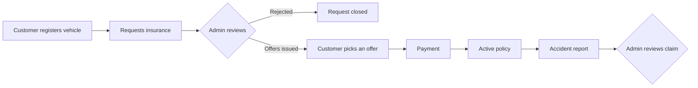

# Car Insurance App

A cross-platform **Flutter + Firebase** app that takes a car through its whole insurance lifecycle: register the vehicle, request a quote, get approved, pay, and file accident claims — with a separate dashboard for insurance administrators.


<!--
Screenshots: add images to docs/screenshots/ and uncomment this table.

| Login | Customer home | Insurance offers | Admin dashboard |
|-------|---------------|------------------|-----------------|
|  |  |  |  |
-->

## Highlights

- **Two roles, one app.** After sign-in, the user's `role` in Firestore routes them to either the customer app or the admin dashboard.
- **Real-time data.** Vehicles, requests, policies and reports are streamed from Cloud Firestore, so admin decisions show up on the customer's screen immediately.
- **Rule-based pricing.** Quotes are calculated from the car's depreciated value and its accident history (see [Pricing rules](#pricing-rules)).
- **Evidence uploads.** Vehicle photos and accident photos are uploaded to Firebase Storage.
- **Notifications.** In-app notifications are stored per user in Firestore; device tokens and topic subscriptions are managed through Firebase Cloud Messaging.

## Features

| Customer | Administrator |
|----------|---------------|
| Sign up and sign in with email and password | Dashboard with insurance and claims activity |
| Register vehicles with details and photos | Review insurance requests and issue Basic / Standard / Premium offers |
| Edit and search vehicles | Approve or reject requests |
| Request insurance and choose an offer | Manage active policies |
| Pay for an approved policy | Review accident reports and update their status |
| View policies and their status | Create additional admin accounts |
| Report an accident with photos and repair cost | |

## How it works



### Pricing rules

| Rule | Value |
|------|-------|
| Yearly depreciation of the car's value | 10% (15% after a heavy-damage accident) |
| Heavy damage | Repair cost above 40% of the car's value |
| Basic / Standard / Premium premium | 5% / 7% / 10% of the car's value |
| Accident surcharge | ×1.2 if the car has had an accident |

## Tech stack

| Area | Tools |
|------|-------|
| UI | Flutter (Material), `animate_do`, `flutter_staggered_animations` |
| Auth | Firebase Authentication (email/password) |
| Database | Cloud Firestore |
| Files | Firebase Storage, `image_picker` |
| Notifications | Firebase Cloud Messaging, `flutter_local_notifications` |

## Project structure

The code is organised by feature, with shared code kept in `core/` and `shared/`:

```text
lib/
├── main.dart                 # Entry point: Firebase + notifications setup
├── app.dart                  # MaterialApp, routes and the role-based AuthGate
├── firebase_options.dart     # Firebase project configuration
├── core/
│   ├── services/
│   │   ├── notification_service.dart   # FCM tokens, topics, in-app notifications
│   │   └── storage_service.dart        # Image uploads to Firebase Storage
│   └── theme/app_theme.dart            # Colours, gradients and Material theme
├── shared/
│   ├── utils/input_formatters.dart     # Card number / expiry formatters
│   └── widgets/car_card.dart           # Reusable vehicle card
└── features/
    ├── auth/        # login_page, register_page
    ├── home/        # Customer dashboard
    ├── vehicles/    # Register and edit vehicles
    ├── insurance/   # Request insurance, view policies, payment
    ├── accidents/   # Accident reports
    └── admin/       # Admin dashboard, insurance management, claim review
```

## Data model (Cloud Firestore)

| Collection | Contents |
|------------|----------|
| `users` | Profile and `role` (`Admin` or customer) |
| `users/{uid}/tokens` | FCM device tokens |
| `users/{uid}/notifications` | In-app notifications |
| `vehicles` | Vehicle details, photos, value, depreciation rate, accident flag |
| `insurance_requests` | Requests, offers, chosen plan, payment and policy status |
| `accident_reports` | Claims with date, description, damaged parts, cost and photos |

## Getting started

### Prerequisites

- Flutter SDK with Dart 3.8 or later
- Android Studio / Xcode, or Chrome for the web build
- A Firebase project with **Authentication (email/password)**, **Cloud Firestore**, **Storage** and **Cloud Messaging** enabled

### Run locally

```bash
git clone https://github.com/ze0o/car-insurance-app.git
cd car-insurance-app
flutter pub get
flutter run
```

### Use your own Firebase project

The app points to the original project (`itcs444-proj`). To use your own:

```bash
dart pub global activate flutterfire_cli
flutterfire configure
```

This regenerates `lib/firebase_options.dart`. Then create an admin by setting `role: "Admin"` on that user's document in the `users` collection.

### Useful commands

```bash
flutter analyze   # static analysis
flutter test      # unit tests
flutter build apk # Android release build
```

## Security notes

- The values in `firebase_options.dart` are client identifiers, not secrets. Data is protected by **Firestore and Storage security rules**, which must restrict customers to their own documents and admin actions to users with `role == "Admin"`. The rules are not part of this repository yet.
- Never put an FCM server key or a service-account file in the app. Remote push sending is disabled in the client; move it to a Cloud Function that uses the FCM HTTP v1 API.
- Payment is simulated: no card data is stored or sent anywhere.

## Roadmap

- [ ] Add Firestore and Storage security rules to the repository
- [ ] Send push notifications from a Cloud Function (FCM HTTP v1)
- [ ] Integrate a real payment provider
- [ ] Add widget and integration tests for the main flows
- [ ] Generate per-platform Firebase options with `flutterfire configure`

## Author

**Abdulaziz Alsakran** — Software Engineering, University of Bahrain
GitHub: [@ze0o](https://github.com/ze0o)

Originally built as a course project (ITCS 444).
